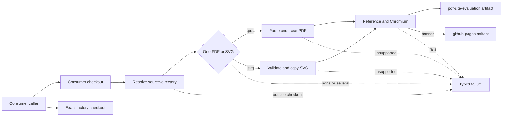

# PDF and SVG Build Contract

## Behavior Flow

## Description

The caller supplies a title, an optional source directory, and a repository checkout. Discovery reads only the selected directory of the consumer checkout. Templates and executable source come only from the exact factory-workflow commit. A PDF keeps the parsing and output behavior of the accepted PDF decisions. An SVG ships unchanged and is drawn as an isolated image. Evaluation evidence is retained independently, and the deployable artifact exists only after every required gate passes.

This BDR replaces [BDR 0002](/bdr/0002-reusable-workflow-build-contract.md). Its scenarios 1 to 8 continue below in source-neutral form.

## Scenarios

1. Given a consumer with one supported PDF or SVG and a valid title, when it calls the workflow, then `github-pages` and `pdf-site-evaluation` are uploaded.
2. Given zero sources, several sources, a PDF together with an SVG, a symlinked source, or a multi-page PDF, when discovery or parsing runs, then the build fails with a typed error and uploads no `github-pages` artifact.
3. Given supported content with source-specific dimensions or scene counts, when validation runs, then no source-specific count gate rejects it.
4. Given unsupported PDF content, an ambiguous soft mask, or SVG content that an isolated image would drop, when parsing runs, then a typed failure names the content instead of silently omitting it.
5. Given an evaluation outside any fixed threshold, when comparison completes, then evidence is uploaded and the Pages artifact is withheld.
6. Given a consumer deployment job, when the reusable build succeeds on `main`, then the consumer may deploy without giving Pages permissions to the factory build job.
7. Given a workflow loaded from a moving reference, when the build starts, then factory source is checked out from `job.workflow_sha`, not independently from the moving reference.
8. Given a removable path that overlaps source, templates, or another output root, or uses a symlink target or unresolved symlink parent, when path validation runs, then the command fails before mutation.
9. Given a caller that omits `source-directory`, when the workflow runs, then discovery searches the repository root as before.
10. Given a `source-directory` that is missing, is not a directory, or resolves outside the consumer checkout, when the workflow starts, then it fails before building.
11. Given an SVG with absolute root `width` and `height`, when it is interpreted, then the board measures those lengths in CSS pixels. Given neither, the board takes the `viewBox` size. Given exactly one, the build fails.
12. Given a valid SVG, when the site is built, then `assets/board.svg` is byte-identical to the source and the scene holds one `svg-document` node covering the board.
13. Given an `svg-document` node, when the viewer renders and zooms it, then its `<image>` keeps board units without a transform, and readiness waits for it to load.
14. Given an SVG source, when evaluation runs, then the reference is Chromium's direct rendering of the source at the board size, and the evidence names that reference.

## Test Design

| Scenario | Instrument | Proof |
| --- | --- | --- |
| 1 | `ci.yml` and `ci-svg.yml` reusable-workflow runs and real consumer runs | Standard artifacts are produced for each format. |
| 2 | `sourceAt` unit test, CLI discovery checks, and PDF page-count parser behavior | Invalid source cardinality blocks output. |
| 3 | Synthetic fixtures and real consumers | Output validation is source-independent. |
| 4 | Focused PDF interpreter and classification tests, and one `interpretSvg` test per rejected SVG construct | Unsupported content fails explicitly. |
| 5 | `make evaluate` plus `report.html` inspection | Threshold failure cannot deploy. |
| 6 | Consumer caller permissions and deployment job | Deployment authority remains consumer-owned. |
| 7 | Workflow checkout configuration and GitHub Actions runs | Workflow and implementation commits match. |
| 8 | Focused path-relation tests and symlink and overlap CLI checks | Input, site, and evidence ownership cannot be erased or mixed. |
| 9, 10 | Local execution of the resolve step for default, nested, `..`, symlink-escape, missing, file, and absolute inputs | Only directories inside the checkout are searched. |
| 11 | `interpretSvg` board-size unit tests | Each size rule holds. |
| 12 | Byte comparison of the built fixture, and the `svg-document` validation and serialization tests | The source ships unchanged. |
| 13 | `make test-runtime` DOM check and close-zoom board-unit regression | The image stays in board units. |
| 14 | `make evaluate` on the SVG fixture and `evaluation.json` inspection | The SVG reference is used and recorded. |

# References

1. [Superseded build contract](/bdr/0002-reusable-workflow-build-contract.md)
2. [PRD 0011](/prd/0011-reusable-pdf-and-svg-site-factory.md)
3. [ADR 0017](/adr/0017-isolated-svg-source-images.md)
4. [Issue 0020](/issues/0020-support-svg-sources.md)
